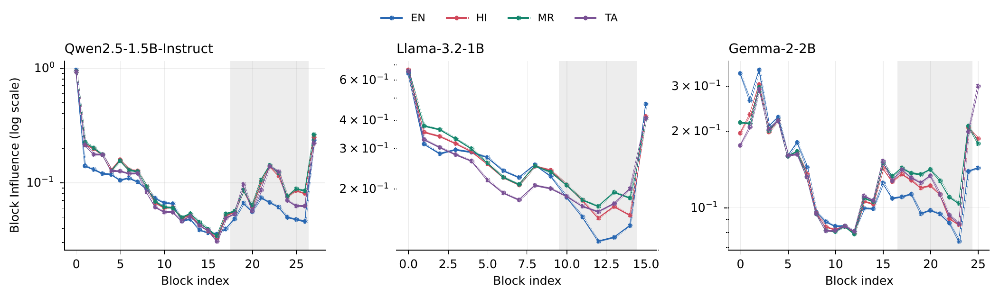
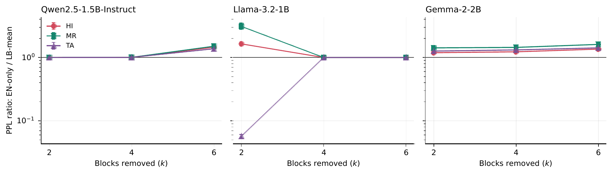

<div align="center">

# Calibration Language Shapes Block-Influence Pruning in Multilingual Language Models

**Vedant Pandhare** · **Piyush Dhoka**

Independent Researchers

[Paper (arXiv, coming soon)](#citation) · [Results](results/) · [Experiment notebook](code/v4_robust_language_balanced_block_pruning.ipynb)

[](LICENSE)


</div>

---

**TL;DR.** Block Influence (BI) is a training-free score used to choose which
Transformer blocks to delete. We show that the score depends on the
calibration language. English-only calibration systematically underestimates
late-block influence for Hindi, Marathi, and Tamil in Qwen2.5-1.5B-Instruct,
Llama-3.2-1B, and Gemma-2-2B, which changes which blocks get pruned.
Language-balanced calibration often repairs the damage, but not on every
architecture or pruning budget.

<p align="center">
  
</p>
<p align="center"><em>Language-conditioned Block Influence. The shaded span is the predeclared late region. English (blue) sits below the Indian languages exactly where low-BI blocks are chosen for removal.</em></p>

## Key findings

1. **English underestimates late-block influence.** In the late region,
   target-language BI is 20.7–55.5% higher than English BI across all nine
   model–language pairs, and every late-minus-middle contrast has a 95%
   bootstrap interval above zero. This includes held-out Tamil, which has a
   different script and language family.
2. **High rank correlation hides different pruning decisions.** English vs.
   target Spearman ρ is 0.898–0.982, yet the selected block sets differ
   (Jaccard as low as 0.33 at k = 2).
3. **Balanced calibration often helps.** Averaging BI over equal
   English/Hindi/Marathi budgets lowers perplexity for Qwen at k = 6
   (English-only PPL is 1.37–1.50× balanced) and for Gemma at every depth
   (1.19–1.61×), including held-out Tamil.
4. **But it is not universal.** On Llama-3.2-1B at k = 2, balancing helps
   Hindi and Marathi but raises Tamil perplexity about 17.5×. At larger
   budgets both selectors pick the same blocks and collapse.
5. **Rank-based aggregators don't beat the raw mean.** Rank mean and minimax
   rank never dominate the raw BI mean.

<p align="center">
  
</p>
<p align="center"><em>PPL(English-only) / PPL(balanced). Values above 1 favor balanced calibration. Note the Llama–Tamil reversal.</em></p>

## Setup

| | |
| --- | --- |
| Models | `Qwen/Qwen2.5-1.5B-Instruct` (28 blocks), `meta-llama/Llama-3.2-1B` (16), `google/gemma-2-2b` (26) |
| Languages | English, Hindi, Marathi (calibration + evaluation); Tamil (held out from balancing) |
| Data | Wikipedia 2023-11-01, 200 calibration + 200 disjoint evaluation articles per language, 256-token chunks |
| Selectors | EN / HI / MR / TA monolingual; balanced raw mean, rank mean, minimax rank; equal 150-chunk budget |
| Pruning | Remove k ∈ {2, 4, 6} blocks; no recovery fine-tuning |
| Controls | 5 calibration seeds, 10 random block sets per k, hierarchical bootstrap CIs |

Exact checkpoint revisions are recorded in each `results/<model>/experiment_config.json`.

## Repository structure

```
.
├── code/
│   ├── v4_robust_language_balanced_block_pruning.ipynb   # main experiment (Colab / A100)
│   ├── tools/
│   │   ├── build_notebook.py         # generates the v4 notebook deterministically
│   │   ├── run_nb.py                 # headless notebook executor
│   │   ├── make_v4_paper_assets.py   # figures and tables from results/
│   │   └── audit_claims.py           # checks the paper's key numbers against results/
│   └── legacy/                       # v1-v3 notebooks and executed v3 runs (historical only)
├── data/calibration-cache/           # cached EN/HI/MR Wikipedia samples (seed 42)
├── results/{qwen,llama,gemma}/       # canonical v4 outputs (see results/README.md)
├── docs/
│   ├── figures/                      # figures used in this README
│   └── research-guide.md             # original research protocol
├── requirements.txt
├── CITATION.cff
└── LICENSE
```

## Installation

```bash
git clone https://github.com/VedantPandhare/Language-Balanced-Depth-Pruning-of-Small-Multilingual-LLMs.git
cd Language-Balanced-Depth-Pruning-of-Small-Multilingual-LLMs
pip install -r requirements.txt
```

## Reproducing the paper

### 1. Verify the reported numbers (CPU, seconds)

```bash
python code/tools/audit_claims.py
# Claim audit passed: provenance, row counts, splits, late contrasts, and key PPL ratios.
```

This checks checkpoint provenance, row counts, the article-disjoint splits,
all nine late-layer contrasts, and the key English-vs-balanced perplexity
ratios against the released results.

### 2. Re-run the experiments (GPU)

The reported runs used one NVIDIA A100-SXM4-40GB, bfloat16, Transformers
4.56.2, and PyTorch 2.11.0+cu130. Llama and Gemma are gated, so you need
access on Hugging Face first:

```bash
hf auth login
cd code
mkdir -p ../executed_runs_v4
for MODEL in qwen llama gemma; do
  RUN_REFERENCE_SWEEP=1 RUN_BUDGET_SWEEP=0 RUN_BELEBELE=0 MODEL_KEY=$MODEL \
    python tools/run_nb.py v4_robust_language_balanced_block_pruning.ipynb \
      ../executed_runs_v4/v4_$MODEL.ipynb .
done
cd ..
```

Outputs are written to `results/<model>/`. Set `RESULTS_ROOT` and
`DATA_CACHE_DIR` to persistent paths (for example, Google Drive on Colab).
Influence arrays and every evaluated pruning configuration are cached, so an
interrupted run resumes where it stopped. The notebook is generated from
`code/tools/build_notebook.py`, so edit that file rather than the notebook.

### 3. Rebuild figures and tables

```bash
python code/tools/make_v4_paper_assets.py   # writes paper_v4_assets/ (override with PAPER_ASSETS_DIR)
```

## Limitations

- Three models of 1.2B–2.6B parameters; results may not transfer to larger
  models or other families.
- Evaluation is Wikipedia language-modeling perplexity, not downstream tasks
  or generation quality.
- BI itself is brittle on Llama-3.2-1B: at k = 2 and k = 4, BI-selected sets
  do worse than the random-set average.
- Calibration language should be treated as part of the pruning algorithm
  and validated per model, pruning budget, and deployment language.

## Legacy experiments

`code/legacy/` contains the v1–v3 notebooks, the executed v3 runs, and the v3
asset builder for provenance. v2 fixed several v1 issues, including
calibration/evaluation leakage and last-block influence measured after the
final RMSNorm (see the change table in `code/tools/build_notebook.py`). None
of the legacy outputs are used in the paper.

## Citation

If you use this code or these results, please cite the paper. The arXiv
identifier will be added here once it is available.

```bibtex
@misc{pandhare2026calibration,
  title  = {Calibration Language Shapes Block-Influence Pruning in Multilingual Language Models},
  author = {Pandhare, Vedant and Dhoka, Piyush},
  year   = {2026},
  note   = {Preprint}
}
```

## License

Code and released results are under the [MIT License](LICENSE). Model weights
are not redistributed and remain under their original licenses. Wikipedia
text is licensed under CC BY-SA.

## Contact

Vedant Pandhare (vedant11734@gmail.com) · Piyush Dhoka (piyushdhoka007@gmail.com)
